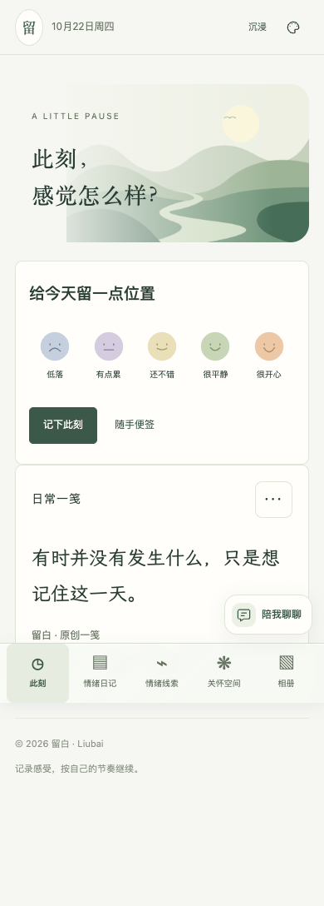

# liubai-alittlepause

Some thoughts do not belong on a public feed. You finish a long day knowing you feel tired, but cannot quite remember where that feeling began. Photos stay scattered in your camera roll; the diary you started trails off on a Wednesday.

liubai-alittlepause gives those moments a place. Pick a mood and write a few words. Add a photo, record your voice, or put them together on a scrapbook page. Come back later through the calendar, follow an ongoing story across dates, or gather a week into a printable booklet. There is no streak to protect, and an unrecorded day is never treated as a calm day.

Use the web app when you have time to write, or the browser extension’s popup for a quick check-in. Start in immersive mode with the full set of tools, switch to a simple mode, or pick features individually. Local recording needs no account. AI conversations and cross-device backup sync are separate, optional connections to a service you host or trust.

**[Try the web app](https://workstonedai-collab.github.io/liubai-alittlepause/) · [Download web and extension packages](https://github.com/workstonedai-collab/liubai-alittlepause/releases/latest) · [中文](README.md)**



## What can you do?

- **Keep a moment:** mood, text, optional tags, editable entries and durable local drafts.
- **Make a scrapbook:** photos, text, drawings, stickers, paper styles, 17 bundled illustrations, reusable layouts and image export.
- **Keep a voice note:** explicit microphone permission, recording controls, local playback and export. No automatic transcription or AI upload.
- **Look back:** calendar, text search, feeling/energy/need notes, ongoing stories, weekly pages and downloadable booklets.
- **Choose your own pace:** four palettes; simple, immersive, private-care and custom feature modes; a personal center and introductory tour.
- **Share deliberately:** preview a journal or daily-line image before downloading. Scrapbooks export as images. Personal text and photos visible in an image will be shared with it.
- **Back up your records:** portable ordinary-space or care-space backups, attachment backups and compatible legacy text imports.

## Run locally

Node.js 22 or later is required. No third-party runtime packages or model keys are needed for local recording.

```bash
git clone https://github.com/workstonedai-collab/liubai-alittlepause.git
cd liubai-alittlepause
npm run dev
```

Open **http://127.0.0.1:4187**. Starting the app does not make a model request.

If you prefer working with an agent, give it this repository and ask it to follow the setup guide. Try the local tools first, then decide whether you need a server or AI. This project does not include shared model credentials or use the author’s WeChat cloud quota.

## Browser extension

```bash
npm run build:extension
```

In Chrome or Edge, open the extension manager, enable Developer mode, choose **Load unpacked**, and select **dist/extension**. Prebuilt packages are also available in [Releases](https://github.com/workstonedai-collab/liubai-alittlepause/releases/latest).

The popup and full extension page share the extension’s local records. The full page uses the same application as the web edition. No content script reads other websites. Optional host access is requested only when you explicitly configure a self-hosted service.

The website, extension and WeChat mini-program have separate storage. Website/extension portable backups can be transferred manually. You may also explicitly connect both to one Liubai service for manual upload, download and merge. Native WeChat backups use different attachment paths and cannot currently be restored directly in the web edition.

## Optional services

The included Node server supports provisioned accounts, manual ordinary-space backup sync, a feedback inbox with maintainer replies, and a Tencent Hunyuan adapter for AI conversations and 7/30-day reflections.

AI is off by default. Deployers supply their own Hunyuan model and server-side key. Each request needs a sending preview and explicit consent; only selected text and enabled preferences/background notes enter the request. Photos and audio do not go to the model. An unconfigured service reports that it is disconnected rather than returning a fabricated reply.

Sync is manual. Private care, AI conversations, response preferences and memories are excluded. Conflicting record IDs stop import instead of overwriting local records. The server stores a versioned backup, not a continuous collaborative database. The inbox does not send email or push notifications.

See [self-hosting](docs/self-hosting.md), [platform differences](docs/feature-parity.md), and [privacy](docs/privacy.md). Setup documents are currently primarily in Chinese; commands and environment-variable names are shared.

## Data and privacy

Text/settings use browser local storage; attachments use IndexedDB. Portable backups include saved records and attachments; unfinished drafts must first be saved or downloaded separately. Existing text backups remain supported through the legacy backup entry.

Local storage, portable backups and server snapshots are **not encrypted**. Clearing browser data, uninstalling an extension or changing devices can remove records. Keep your own backups. Different browser databases cannot share a transaction; an import interrupted by a storage failure can leave a partial merge. Retain the original backup file.

Public hosting of the optional service needs HTTPS, account administration, backups and access management. The GitHub Pages edition supplies local tools only, without a shared backend or a free AI proxy.

## Development

```bash
npm test
npm run check
npm run build:all
```

Tests use fictional accounts and records, with an injected AI transport. They do not make paid provider requests. Optional browser acceptance uses Playwright; see [validation](docs/validation.md).

Code is provided under the [MIT License](LICENSE). See [asset and quotation notes](ASSETS.md) for fonts, artwork and public-domain excerpts. Report issues without posting personal diaries, photos, passwords or backups. The WeChat edition is awaiting review; publishing this repository does not publish that mini-program. Liubai is a journaling and self-reflection tool, not medical treatment.
