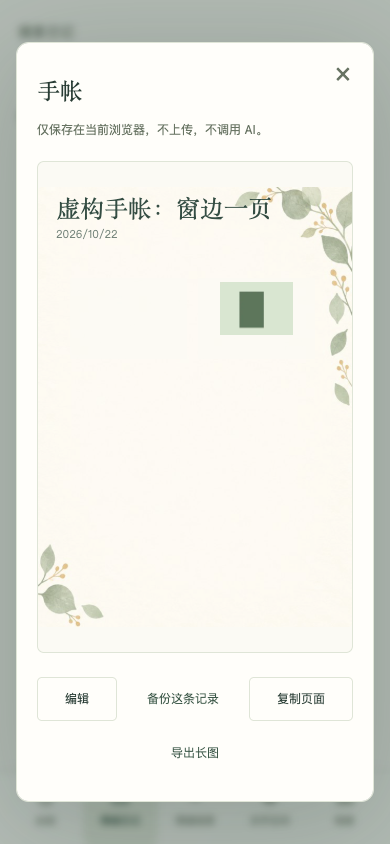

# 留白 · A Little Pause

有些话不想发朋友圈，又想给自己留个地方。忙完一天，记得有点累，却已经想不起是从哪件事开始的。照片散在相册里，写过几次的日记，也常常停在某个星期三。

留白是一个可以随手打开的情绪日记。选个心情，写两句；愿意多留一点，就放张照片、录一段声音，或把它们排成一页手帐。隔些日子再来，用日历找回一天，把同一件事的后续归在一起，整理成周笺和小册子。没有连续打卡的要求，也不会把漏记的日子当成“心情稳定”。

你可以在网页里慢慢写，也可以从浏览器扩展的小弹窗记下此刻。首次打开默认使用“沉浸”，手帐、回看和关怀练习都能找到。只想简单记录，可以切到“轻记”，也能逐项自选功能。默认保存在本机，不登录也能用。AI 对话和跨设备同步需要另外连接自己的服务，发送什么、什么时候上传，都由你确认。

**[打开网页版](https://workstonedai-collab.github.io/liubai/) · [下载网页与扩展](https://github.com/workstonedai-collab/liubai/releases/latest) · [中文使用说明](README.zh-CN.md) · [English](README.en.md)**

<p> </p>

## 先写一句，再决定要用多少功能

| 你现在想做什么 | 留白里可以怎样做 |
| --- | --- |
| 只想记下今天，不想填一长串表格 | 选个心情，写几句话。草稿会留下，之后还能改 |
| 拍了照片，想连当时的话一起留下 | 做一页手帐：放照片、文字、贴纸和笔迹，选择信纸与插画 |
| 最近一直在经历同一件事 | 建一个主题，把不同日期的记录放在一起 |
| 回看这一周，想留一点具体的东西 | 挑选记录，写周笺，或编成可下载、打印的小册子 |
| 不想被建议淹没，只想说说 | 选择“先听我说”，也可以保存回应偏好；AI 需要你自选服务 |
| 有些内容只想留给自己 | 切到独立的关怀空间，本机保存，不使用云端 AI 和同步 |
| 页面上的功能太多 | 切换轻记、沉浸、关怀或自选；关闭入口保留已有内容 |

四种底色、17 张内置插画与信纸、可选贴纸和本机照片，都能慢慢换。日常一笺保留作者与出处，也可以写自己的句子。喜欢的日记和一笺能导出分享图；手帐可以导出长图。分享前先看预览。

## 本机运行，不需要密钥

需要 Node.js 22 或更高版本。应用和服务不依赖第三方运行时包，下面几步即可打开：

```bash
git clone https://github.com/workstonedai-collab/liubai.git
cd liubai
npm run dev
```

在浏览器访问 **http://127.0.0.1:4187**。无需注册，也不会因为启动项目而调用模型。

如果你不熟悉编程，可以把仓库交给自己的 Agent，让它按[安装说明](docs/getting-started.md)带你运行。先用本机功能，再决定是否配置 AI 或多设备服务。仓库不提供共享密钥，不会借用作者的小程序额度。

## 把留白放到浏览器工具栏

```bash
npm run build:extension
```

在 Chrome 或 Edge 的扩展管理页开启“开发者模式”，选择“加载已解压的扩展程序”，打开 **dist/extension**。也可以从 [Release](https://github.com/workstonedai-collab/liubai/releases/latest) 下载打好的扩展包，解压后加载。

小弹窗用于快速记下心情与文字；“打开完整日记”提供与网页相同的手帐、语音、图库、情绪回看和设置。两者共用此扩展的本机数据。扩展不会读取正在浏览的其他网页，也没有内容脚本；只有你配置自托管服务时，才会请求连接该服务的可选网站权限。

**网页、扩展和微信小程序是不同的存储空间。** 不会因为使用同一台电脑就自动互通。网页与扩展可通过本项目的完整备份手动迁移；也可显式连接同一个自托管服务，上传、下载并合并普通空间备份。旧版文字 JSON 仍可从“旧版备份”入口导入。微信小程序完整备份格式与附件路径不同，当前不支持直接跨格式恢复。

## AI、同步和来信怎样接入

静态网页版和扩展的本机功能可以独立使用。需要联网功能时，再运行仓库中的可选服务：

- **AI 对话与回望**：沿用留白的倾听、整理、一个小办法三种回应方式。可选最近 7 天或 30 天的文字记录，先预览再确认发送。服务适配腾讯混元接口，部署者自行配置模型及密钥。
- **手动跨设备同步**：维护者创建账号。登录后可以上传普通空间完整备份、下载并合并、单独下载云端文件，或删除服务器上的同步副本。版本冲突会停止写入。
- **意见与回复**：用户的来信进入所连接服务的来信箱；维护者可读取并回复，用户重新打开后可看到。没有自动发送邮件或通知。

这三项需要你自己的服务和账号。AI 默认关闭；未配置时会直接说明，不会生成模拟回复。**小程序的成长计划额度不能直接当作网页 API 余额使用**，是否适用需要另外核对平台权限。本次公开版不包含作者的账号配置、密钥或云环境绑定。

[自托管与混元配置](docs/self-hosting.md) · [功能对照与平台差异](docs/feature-parity.md) · [数据与隐私](docs/privacy.md)

## 记录怎样留下来

文字和设置保存在浏览器本机存储，照片、录音与手帐附件保存在 IndexedDB。草稿有保存状态，删除的记录可从原有回收入口找回；本机空间读取失败时不会用空白状态覆盖原内容。

“我的 → 备份与恢复”可以下载当前空间的完整备份，包含文字、便签、主题、周笺、小册子、关怀方法及已保存附件。未完成草稿需先保存或单独下载。AI 对话与偏好不进入云同步。发生同 ID 的日记或媒体版本冲突时，合并会停止；浏览器各存储区无法进行共同事务，存储故障可能留下部分已导入内容，请保留原备份文件。

**本机存储和导出的备份没有加密。** 清理浏览器数据、卸载扩展或换设备都可能让本机内容丢失，请定期备份。若把自己的服务部署到公网，还需要 HTTPS、账号维护、存储备份和访问管理。

## 开发与参与

```bash
npm test              # 本机模型、存储与服务边界测试，虚构数据，无付费调用
npm run check         # JavaScript 语法与相对引用
npm run build:all     # dist/web 与 dist/extension
```

网页版与插件共用界面、数据模型和主要功能，避免两端越用越不一样。可选浏览器验收脚本为 `tests/browser.cjs`，需要另行安装 Playwright 与 Chromium，使用说明见[验证记录](docs/validation.md)。

欢迎在 [Issues](https://github.com/workstonedai-collab/liubai/issues) 写下使用中的问题。请描述版本、浏览器、操作步骤和预期结果，不要附上真实日记、私密照片、账号口令或完整备份。

代码按 [MIT](LICENSE) 开放。插画、字体与引文的来源和适用条件见 [ASSETS.md](ASSETS.md)。微信小程序仍在审核中；这个仓库交付网页和浏览器扩展，不代表小程序已经发布。情绪记录与关怀工具用于自我梳理，不能替代专业诊疗。
